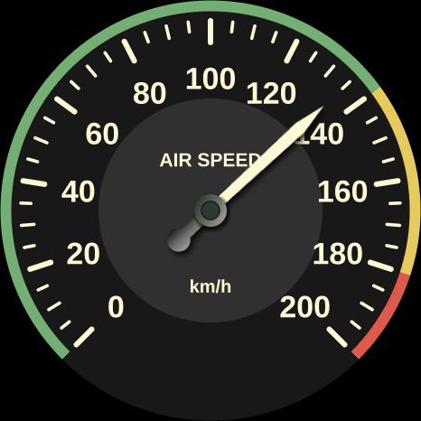
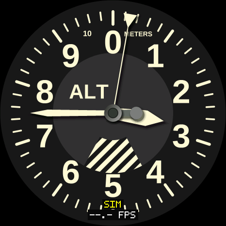
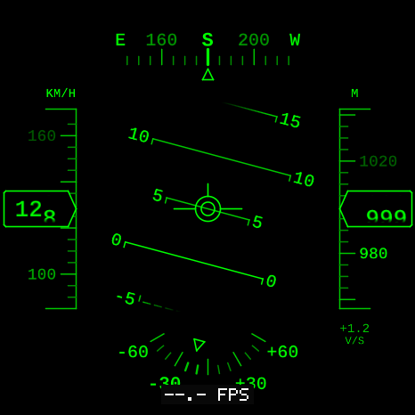
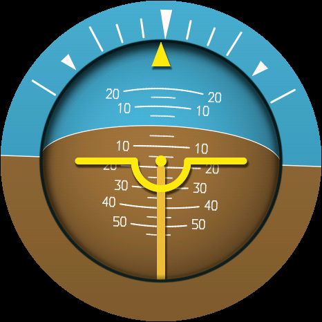

# 航模座舱圆形仪表：空速 / 姿态 / 高度 / HUD

为 **Waveshare ESP32-S3-Touch-AMOLED-1.75** 编写的四仪表固件，以 466×466 原生分辨率显示。开机进入使用板载 QMI8658 的圆形姿态仪，上滑依次切换 HUD、空速表、米制高度计并回到圆形姿态仪，下滑反向循环。UI 由 C++ 几何图形及 Orbitron Bold 字形子集绘制。

**空速和高度目前均为模拟输入**，空速表和高度计底部持续标记 `SIM`；HUD 底部叠加实测 FPS，其空速、高度、升降率和航向同样为模拟数据。真实空速和高度传感器及其通信协议尚未接入；姿态继续使用板载六轴 IMU。

## 空速表

空速使用静态表盘缓存、局部刷新和 TE 同步，指针绘图与 DMA 传输在两个核心上重叠执行。更新窗口的两轴都按 2 像素对齐；内部 DMA 缓冲区等传输完成后才复用。板载实测记录见 `docs/airspeed-validation.md`。

- 量程 **0–200 km/h**，270° 指针行程；每 20 km/h 标数字，每 5 km/h 一格。
- 奶白色粗字、圆头刻度、深灰内盘、金属轴帽及柔和指针投影。
- 色带宽 12 像素并贴住圆形外沿：绿 0–140、黄 140–180、红 180–200。这些是视觉示例区间，不代表某个机型的飞行限制。
- 启动时生成静态表盘与指针缓存；逐帧无动态分配，复用双缓冲分带 / QSPI DMA 流水线。指针与阴影的透明度掩膜采用双线性采样，奶白和金属颜色由代码计算。两张掩膜共约 24 KB，优先放入内部 SRAM；静态表盘放入 PSRAM。
- 默认自动演示；可用串口 `d` 暂停 / 恢复。串口 `v135` 加换行可将模拟目标设为 135 km/h；越界值限幅到 0–200，格式错误或非有限值被忽略。
- 空速表和高度计共用 Orbitron Bold 矢量轮廓，圆形姿态仪和 HUD 共用同一份字形点阵。许可证见 `firmware/AttitudeIndicator/HUD_FONT_LICENSE.txt`。



## 高度计

- 量程 **0–3,000 米**，表面标注 `ALT / 10 METERS`。黑色表盘、深灰内盘、奶白色 0–9 数字、50 个圆头刻度；保留参考图的金属轴帽、配重和底部斜纹细节。
- 三针连续转动：长针每圈 **100 m**（每个数字 10 m，每小格 **2 m**）；短粗针每圈 **1,000 m**；三角细针每圈 **10,000 m**。按千米、百米、十米顺序读数，例如 **275 m = 0 + 200 + 75 m**：三角细针在 0 附近，短针在 2 与 3 之间，长针在 7 与 8 正中间。
- 模拟输入范围 **0–3,000 m**，包含上限；默认在约 **125–425 m** 之间自动升降。串口 `b275` 加换行切换到高度计、停止演示并平滑移动到 275 m。非有限数和错误格式被忽略，越界数限幅。
- 指针使用抗锯齿扫描线与柔和投影。静态表盘放入 PSRAM；逐帧仅恢复旧、新指针覆盖的区域，两核同时绘制交错的水平区域，汇合完成后再交给 DMA。每个在途缓冲保留独立指针几何，避免互相覆盖。
- 刷新区域按从上到下排列，并保持 X、Y、宽、高为偶数；沿用 GPIO 13 的 TE 同步。底部居中显示实测 FPS，受影响的 `SIM` 和 FPS 标签随区域恢复。

板载连续演示实测 **46.9–60.8 FPS，中位数 51.8**，固定 275 米时约 **60.7 FPS**。实物测试和性能记录见 [0–3,000 米高度计验证](docs/altimeter-3000m-validation.md)。下图由固件同一份 C++ 绘图代码导出，离线预览的 FPS 显示 `--.-`。



## HUD

- 荧光绿圆形界面，带按变化数位连续滚动的读数、平滑放大提亮刻度、同尺寸三角指针和中心双圆环；侧轴内侧三角形与读数框短横线不再绘制。
- 串口 `u` 进入 HUD；默认俯仰/横滚取板载 IMU。空速、高度沿用现有模拟源，升降率由模拟高度变化计算，航向也是模拟值，**没有真实航向测量**。串口 `d` 切换 HUD 独立的全模拟演示，`c` 退出姿态演示并校准。
- 缺失或陈旧的 IMU 姿态不会用于绘图；HUD 保留其他刻度并显示 `IMU`。横滚尺显示到 ±60°，俯仰梯仍可随真实姿态转到倒飞方向。
- 复用双缓冲和 TE 同步：首帧全屏清理，后续按旧、新图形覆盖的变化区域局部刷新，最多 40 个区域；连续排队 DMA 传输。字形使用25 KiB 的 Orbitron Bold 抗锯齿子集，固件保存在 Flash，启动后放入内部 SRAM 供圆形姿态仪与 HUD 共用。滚动读数按固定字宽排版，网页预览复用同一份字形。绘制命令存入 PSRAM，逐帧不分配内存。
- 最新版采用双核绘制、变化区域更新和连续 DMA 排队，连续数字滚动与性能记录见 [HUD 性能与读数验证](docs/hud-40-validation.md)，最新传输顺序修复及帧率见 [倾斜俯仰刻度验证](docs/hud-tear-validation.md)。底部仍复用其他表盘同款白字深灰底 FPS 覆盖层，不移动横滚刻度或为 FPS 留白。



校准按键实现与实板验证见 [统一校准](docs/shared-calibration-validation.md)。

## 姿态仪



- 蓝天、棕地、球面渐变、白色刻度、黄色固定飞机标，完整正圆。内外地平线加粗，俯仰每 10° 一格，外圈保留 ±10°、30°、45° 和 60° 横滚标记，方便通过 FPV 镜头辨认。内环采用方向性凹陷阴影与 4×4 边缘采样；黄色指针有柔和投影，支杆延伸到下缘并被环口遮住，已去掉底部梯形。
- 底部横向居中显示实际 FPS，约每秒更新；包含绘图、传屏和等待时间，首个统计窗口显示 `--.- FPS`。
- 内球面随俯仰/横滚运动；外圈地平线为直线，横滚刻度相对固定黄色指针旋转。
- 四元数姿态融合、开机静止校准、安装倾角归零、显式演示模式。
- IMU 与显示分别运行；读数异常、饱和或超时会停止显示有效姿态并重新校准。
- 本机交互预览直接运行固件的同一份 C++ renderer，不另写一套近似图形。
- 原生测试和 ESP32 固件编译通过，已烧录并完成写入校验。当前采用按物理扫描顺序绘制、内部几何/字体缓存、双核分担变化区域、双缓冲及 TE 同步。四个安装方向的本轮实板帧率和验证范围见 [四向性能验证](docs/four-orientation-performance.md)。旧版阴影优化记录保留于 `docs/validation.md`。USB 日志采用非阻塞发送。默认 USB 左侧安装，重力轴向已实测核对。

## 查看预览

直接打开 [仪表尺寸对照页](preview/hud.html)，同一处可依次切换圆形姿态仪、HUD、空速表与高度计。默认圆屏直径为 44.5 mm，可输入数值或拖动滑块调整。点击「校准尺寸」，用实体尺测量参考线两端并输入测得的长度。切换表盘或进入全屏对照时保持同一直径，「放大预览」可临时查看细节。换屏或调整浏览器缩放后请重新校准。

空速、姿态和高度使用从固件绘图核心导出的定格画面，HUD 保留交互参数和自动演示。

在项目目录执行：

```sh
sh tools/test.sh
python3 tools/preview.py
```

打开 <http://127.0.0.1:8765>。可调节俯仰/横滚、自动演示及保存 PNG。服务只监听本机。PNG 静态预览也保存在 `preview/reference.png`。

空速 HTML 设计稿为 `preview/airspeed.html`，可直接在浏览器打开。导出同一份 C++ 固件绘图核心的实际画面：

```sh
sh tools/airspeed_test.sh
build/render_airspeed 135 build/airspeed.bmp
sh tools/altimeter_test.sh
sh tools/hud_test.sh
build/render_altimeter 275 build/altimeter.bmp
```

HUD HTML 演示为 [`preview/hud.html`](preview/hud.html)，采用 466 × 466 圆形布局，支持手动调节、飞行预设和自动演示。空速范围 0–200 km/h，高度范围 0–3,000 米。为改善实体屏可读性，主读数放大至 26px，侧轴数字 18px，航向和横滚数字 20–22px，俯仰数字 20px；航向与横滚总宽 208px，长短刻度统一为 17/9px、基准线宽 3.4/2.5px。保留荧光绿、变化数位由轴的连续数值直接驱动：整数部分确定相邻两组数字，小数部分确定滚动位置；未变位固定，无停顿或定时换位、动态 N/E/S/W 端点、平滑强调刻度和带端钩的俯仰梯。小刻度采用航向 10°、空速 10 km/h、高度 10 m、横滚 15°，高度每大格 20 米。俯仰每 10° 一格，长短线交错，宽 152/92 px，间距 80 px，线宽 3.2–5 px。各行跨过中央并逐条标数，负值使用虚线，两端带 6 px 竖线。俯仰区左右扩大至 x=102–364，按实际字形边界判断可见性；数字完整可见时保持全亮，超出可用区域时整组隐藏，俯仰数字不做边缘淡出；侧轴刻度数字靠近读数框、轴端及圆屏边缘时渐隐，航向数字靠近两端时渐隐。上下指针为 12×12px 空心三角，中心双环半径 14/7.5px。单位和升降率居中于对应侧轴横线，主读数按字形垂直居中。该放大布局已同步到固件；HTML 用于交互对照，不能用于推断硬件 FPS。

可直接打开该 HTML，或在项目目录运行：

```sh
python3 -m http.server 8766 --bind 127.0.0.1 --directory preview
```

打开 <http://127.0.0.1:8766/hud.html>。视觉与交互检查记录见 [HUD 设计检查](design-qa.md)。

## 编译和烧录

当前电脑的编译环境已经安装在项目内，可直接执行：

```sh
sh tools/build.sh
sh tools/arduino.sh board list
sh tools/flash.sh /dev/cu.usbmodem21101
```

最后一条会向指定串口设备写入固件；把串口替换成开发板实际端口。该端口曾被识别为 ESP32 家族设备，但软件枚举不能确认具体微雪型号。写入前确认连接的是目标开发板，并根据需要保留原有程序。

构建输出在 `build/firmware/`：

| 文件 | 用途 |
| --- | --- |
| `AttitudeIndicator.ino.bin` | 应用程序，不能作为地址 0 的整包烧录 |
| `AttitudeIndicator.ino.merged.bin` | 合并固件；手动烧录时起始地址 **0x0** |
| `AttitudeIndicator.ino.bootloader.bin` | 引导程序，由上传脚本处理 |
| `AttitudeIndicator.ino.partitions.bin` | 分区表，由上传脚本处理 |

上传脚本使用各个固件文件的正确地址，并开启写入校验。没有自动执行擦除命令。

请保留 sketch 中的 `build_opt.h`，其中的全局参数把官方 QSPI 库容量设为 2048。构建脚本在该文件改变时自动完整重编译，防止复用不同参数的旧库；应用同时按芯片硬件上限限制 DMA 长度。

在新电脑上先安装 Python 3.9+、C++ 编译器和 curl，然后运行 `sh tools/setup.sh`。此脚本下载官方 Arduino CLI、固定版本的 ESP32 core 和微雪驱动；首次下载较大，可重复运行以复用已有文件。Arduino CLI 安装器采用官方 latest，当前验证使用的是 1.5.2-rc.1；核心与微雪库固定版本如下。

### 已验证构建配置

| 配置 | 值 |
| --- | --- |
| Arduino ESP32 core | **3.3.10** |
| Board | ESP32S3 Dev Module / `esp32:esp32:esp32s3` |
| Flash | **16 MB** |
| Partition | `app3M_fat9M_16MB` |
| PSRAM | **OPI PSRAM**（必须启用） |
| USB mode | Hardware CDC and JTAG / `hwcdc` |
| USB CDC on boot | Enabled / `cdc` |
| GFX | 微雪随包版本 1.6.4 |
| QSPI / DMA | 40 MHz；单次最多 16,384 个 RGB565 像素（32 KB） |
| 显示缓冲 | 三个 466×60 内部缓冲；每带直接生成圆形紧凑布局 |
| SensorLib | 微雪随包版本 0.3.1 |
| XPowersLib | 微雪随包版本 0.2.6 |
| 官方库固定提交 | `e4344e70c2fa78a13e8a06566507f1ba8af6672a` |

`tools/fetch_dependencies.py` 从官方提交下载，并用 Git blob SHA-1 核对每个文件。`vendor/SOURCE.json` 记录来源清单；上游许可证随库保留。不要直接替换成不同版本的 GFX/LVGL 示例库。

## 上电与操作

1. 把开发板安装在座舱方向，将模型放在希望定义为零姿态的位置，保持静止。
2. 上电进入圆形姿态仪。IMU 收集 400 个连续稳定样本完成校准；晃动会重新计数。
3. **上滑**：圆形姿态仪 → HUD → 空速表 → 高度计 → 圆形姿态仪；**下滑**反向循环。每次触摸最多切换一次，松手后可再次滑动。校准时显示「请保持静止」。校准结束后，抬头使地平线向下，右机翼向下使地平线逆时针旋转。
4. **右上角 PWR 单击**（屏幕朝你、USB 左侧）：启动统一校准，显示静止提示与进度；保持航模水平静止约 2 秒，完成后返回原表盘。姿态仪与 HUD 共用同一份陀螺仪偏置及安装零点，校准同时关闭它们的姿态演示。重复点击不会打断正在进行的校准。
5. **BOOT 单击**打开设置。触摸「安装方向」选择 USB 在左、上、右或下，屏幕和触摸随即转向。回到表盘时，安装方向若有变化会自动启动统一校准。校准时将屏幕按新方向竖直安装，让航模保持水平静止。触摸「帧率显示」开关四个表盘的 FPS 显示。设置断电保存。BOOT 单击从方向列表返回设置，再单击返回原表盘。串口 `m` 也可以打开或关闭设置，菜单打开时按数字选择对应行。
6. PWR 长按无运行时动作，并关闭 PMU 可配置的长按关机功能。串口 **`c`** 与 PWR 单击使用同一校准流程，`d` 仍可切换当前仪表演示。空速、高度、航向依旧为模拟源。

运行时串口接受 `a`（空速）、`h`（姿态）、`t`（高度）、`c`（姿态校准）、`d`（当前仪表演示切换）、`v135\n`（模拟空速）和 `b275\n`（模拟高度，米）。`v`、`b` 数字命令均以换行结束，会切到对应仪表并停止它的演示；波特率 115200。串口每秒输出仪表模式、模拟空速、高度 `altitude_m`、姿态、有效状态、校准计数、原始加速度、绘图/传屏耗时、最大帧间隔、采样率和剩余内存。空速和高度还输出 `te_us`（屏幕同步周期）、`te_miss`（同步等待超时次数）及 `patch`（本帧更新像素数）。日志使用零等待发送；电脑不读取时丢弃日志，仪表继续运行。BOOT 是启动绑带引脚：正常启动时松开按键。

## 安装方向

`firmware/AttitudeIndicator/board_config.h` 集中定义引脚、亮度和传感器轴映射。

默认安装方向是 **屏幕正对驾驶员、USB 接口在左侧**，黄色三角位于 12 点方向，画面无需额外旋转。实物静止读数核对：竖直时传感器 X 约 +1g，屏幕朝上平放时 Z 约 −0.97g。对应转换为航模 X 向前（进入面板）、Y 向右、Z 向下：

```cpp
return {sensor.z, sensor.y, -sensor.x};
```

该映射同时用于加速度和角速度，保持右手坐标系。默认方向为 USB 在左侧，BOOT 菜单可选择其他侧并同步转换姿态轴。上电时请按保存的方向安装并让航模保持水平。如果在桌面朝上时已经自动校准，装回座舱后单击 PWR 或发送串口 `c` 重新校准。

六轴融合会受振动和持续线性加速度影响，幅值门限只能抑制部分干扰。当前实现适合先做座舱显示及地面验证，持续转弯/高过载下的误差尚未测量。

## 文件结构

| 文件 | 作用 |
| --- | --- |
| `firmware/AttitudeIndicator/AttitudeIndicator.ino` | 硬件初始化、IMU 采样任务、状态与显示循环 |
| `firmware/AttitudeIndicator/attitude.cpp` | 四元数滤波、安装归零、静止校准 |
| `firmware/AttitudeIndicator/renderer.cpp` | 无贴图的完整圆形仪表、扫描线与几何缓存 |
| `firmware/AttitudeIndicator/airspeed_renderer.cpp` | 静态空速表盘、指针与阴影缓存、定点双线性旋转、对齐局部区域 |
| `firmware/AttitudeIndicator/altimeter_renderer.cpp` | 米制三针高度计、抗锯齿与合成阴影、按扫描顺序局部刷新 |
| `firmware/AttitudeIndicator/hud_renderer.cpp` | HUD 几何、字形采样、按需数位滚动与变化区域刷新 |
| `firmware/AttitudeIndicator/altimeter_scale.h` | 高度量程、三针传动比例和演示范围的共用配置 |
| `firmware/AttitudeIndicator/dial_art.cpp` | 空速与高度计共用的静态矢量文字及刻度绘制 |
| `firmware/AttitudeIndicator/panel_sync.h` | GPIO 13 TE 同步、超时回退与测量 |
| `firmware/AttitudeIndicator/instrument_controls.cpp` | 四仪表选择、独立演示状态、模拟空速和米制高度串口输入 |
| `firmware/AttitudeIndicator/display_policy.h` | 分离模拟仪表数据源与姿态有效性判断 |
| `firmware/AttitudeIndicator/display_pipeline.cpp` | 双缓冲背景/前景/DMA流水线、屏幕所有权、完整帧计数 |
| `firmware/AttitudeIndicator/fast_panel.cpp` | 40 MHz QSPI 队列 DMA 传输 |
| `firmware/AttitudeIndicator/fps_overlay.cpp` | 实测 FPS 与演示标记的代码字体 |
| `firmware/AttitudeIndicator/board_config.h` | 引脚和轴映射 |
| `firmware/AttitudeIndicator/circle_band.h` | 保住全部圆内像素的偶数列传输边界 |
| `firmware/AttitudeIndicator/build_opt.h` | 应用与官方显示库共用的编译参数 |
| `tests/` | 本机行为测试与内存边界验证 |
| `tools/render_frame.cpp` | 同一绘图核心的 BMP 导出工具 |
| `preview/index.html` / `tools/preview.py` | 本机预览界面及服务 |

## 官方依据

- [CO5300时序资料（第107页）](https://files.waveshare.com/wiki/common/Co5300_Datasheet.pdf#page=107)
- [Espressif CO5300像素传输实现](https://github.com/espressif/esp-iot-solution/blob/bd85f52467353dae3bd5f551054795287b0042a4/components/display/lcd/esp_lcd_co5300/esp_lcd_co5300_spi.c)

- [产品参数及外设说明](https://docs.waveshare.net/ESP32-S3-Touch-AMOLED-1.75/)
- [官方示例仓库](https://github.com/waveshareteam/ESP32-S3-Touch-AMOLED-1.75)
- [锁定版本硬件说明](https://github.com/waveshareteam/ESP32-S3-Touch-AMOLED-1.75/blob/e4344e70c2fa78a13e8a06566507f1ba8af6672a/HARDWARE_REFERENCE.md)
- [锁定版本显示示例](https://github.com/waveshareteam/ESP32-S3-Touch-AMOLED-1.75/blob/e4344e70c2fa78a13e8a06566507f1ba8af6672a/examples/arduino/01_HelloWorld/01_HelloWorld.ino)

软件验证详情见 `docs/validation.md`。


新增性能回归可单独运行：`sh tools/renderer_stages_test.sh`、`sh tools/renderer_circle_test.sh`、`sh tools/fast_panel_test.sh --prove-regression`。前两项可通过 `SANITIZER=thread` 检查跨线程访问，默认启用地址与未定义行为检查。串口 `render_ms` 是背景/前景经过时间之和，二者可以重叠；实际吞吐以 `fps` 和 `frame_ms` 为准。
