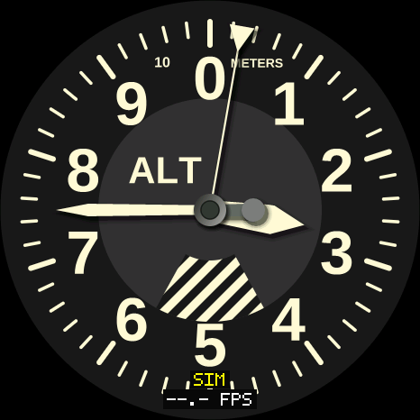

# 航模高度计：0–3,000 米

2026-09-10，按用户选择把高度计输入量程缩至 **0–3,000 米**，同时将三针刻度放大十倍。表盘标注由 `100 METERS` 改为 `10 METERS`，原有颜色、阴影、金属轴帽和三仪表切换保持原样。

## 读法

| 指针 | 一圈 | 每个数字 |
| --- | --- | --- |
| 长针 | 100 米 | 10 米 |
| 短粗针 | 1,000 米 | 100 米 |
| 三角细针 | 10,000 米 | 1,000 米 |

长针每小格 **2 米**。按千米、百米、十米顺序读取：例如 275 米时，三角细针在 0 附近、短粗针在 2 与 3 之间、长针在 7 与 8 正中间，读作 0 + 200 + 75 = 275 米。3,000 米时三角细针指向 3，另外两针回到 0，因此上限不会与零高度混淆。

## 输入与实现

- 高度仍为模拟输入，始终显示 `SIM`。开机默认空速，短按 BOOT 循环选择空速、姿态、高度；长按切换当前演示状态。
- 默认高度 275 米，默认演示约在 125–425 米之间变化。`b275` 加换行设为 275 米并停止高度演示；`b3500` 加换行限幅到 3,000 米。串口数值与 `altitude_m` 日志均使用米。
- `altimeter_scale.h` 共用量程、三针比例和演示参数，使输入、平滑更新与绘图限幅一致。字体、扫描线、阴影缓存、双核交错区域绘制、TE 同步、DMA 所有权及底部标签裁剪沿用已验证的实现。

## 验证

- 修改后的方向探针测试在旧固件绘图代码上失败，修改后的低空演示范围测试在旧控制代码上失败；实现新比例后两者通过。
- `sh tools/altimeter_test.sh`：25 / 50 / 75 米长针方向、250 米短针方向、2,500 米三角细针方向，3,001 米限幅与 3,000 米不混同零高度通过。0 / 100 / 1,000 / 3,000 米附近的局部重建、端点跨越、native/wire、两轴对齐与内存保护通过。
- `SANITIZER=thread sh tools/altimeter_test.sh`：独立姿态槽与双核区域绘制通过。
- `sh tools/airspeed_test.sh`：模拟输入、3,000 米上限、2,999.9 米收敛、负值限幅、非有限值/无效输入拒绝、三仪表状态与既有空速回归通过。
- `sh tools/build.sh`：程序 569,694 字节，静态 RAM 35,092 字节。仅有随包 GFX 库 LCD8 驱动已有的整数收窄警告，本设备使用 QSPI 路径。
- `sh tools/flash.sh /dev/cu.usbmodem21101`：写入和哈希校验通过。
- 导出并检查 275 米与 3,000 米实际绘图，核对单位、针位和标签。离线预览不填入虚构 FPS。

## 板载测量

串口测试覆盖启动空速、高度演示、0 米、越界限幅至 3,000 米、275 米、姿态、返回空速及连续高度演示。原始记录与固件 SHA-256 保存于 [本次测量文件](altimeter-3000m-board-measurements.json)。

| 模式 | FPS 范围 | FPS 中位数 |
| --- | --- | --- |
| 高度 0 米 | 58.7 | 58.7 |
| 高度 3,000 米 | 51.7–52.7 | 51.8 |
| 高度 275 米 | 60.7–60.8 | 60.7 |
| 高度连续演示，45 秒 | 46.9–60.8 | 51.8 |
| 返回空速演示 | 56.7–60.7 | 56.8 |
| 姿态，板子倾斜并有移动 | 37.1–39.4 | 39.1 |

每个阶段先按模式筛选，再剔除前两个样本，避免切换前后的 FPS 窗口混合。45 秒演示收到 44 个样本，统计使用 42 个；全部样本的 FPS 范围也为 46.9–60.8。姿态阶段串口记录到约 24–34° 横滚及角度变化，不能与此前水平静止的 42 FPS 直接比较。

新量程的高度演示实测覆盖 125.3–424.7 米；TE 等待超时始终为 0，未见重启或看门狗报错。IMU 采样为 198.2–202.6 Hz。剩余堆为 14,532–14,672 字节，在第 22、25 个样本处合计变化 140 字节后，末尾 19 个样本保持 14,532 字节。串口日志丢弃计数维持 23，没有继续增加。

绘图两核时间相加为 25.5–38.8 ms，传输为 7.8–11.0 ms；两者有重叠，应以完整显示更新计数的 FPS 衡量吞吐。针位会影响区域大小和帧率，当前并非全程锁定 60 FPS。验证结束保留高度自动演示，开机默认仍为空速。
