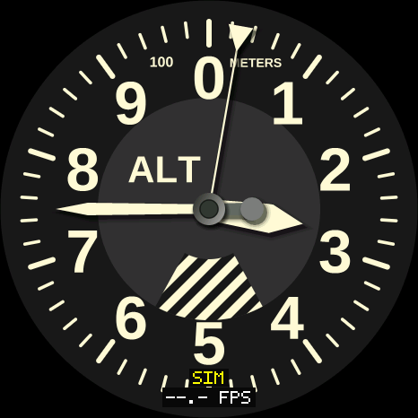

# 米制高度计开发与验证

本文记录最初的 0–99,999 米版本。当前版本已按用户要求改为 **0–3,000 米**、刻度放大十倍；当前读法和实测记录见 [0–3,000 米版本](altimeter-3000m-validation.md)。以下日志及图片保留为历史记录。

日期：2026-09-10。开发板：ESP32-S3-Touch-AMOLED-1.75，466×466 CO5300，240 MHz，40 MHz QSPI。新增第三种仪表，开机仍为空速表，USB 左侧安装轴映射保持原值。

## 显示与操作

高度计采用参考图的奶白色数字、黑色表盘、深灰内盘、三根带阴影的指针、金属轴帽与底部斜纹。表面标注 `ALT / 100 METERS`；长针每圈 1,000 米，短针每圈 10,000 米，三角细针每圈 100,000 米。

输入限于 0–99,999 米，目前由模拟输入驱动，始终显示 `SIM`。没有接入真实高度传感器。短按 BOOT 循环切换空速 → 姿态 → 高度；长按 1.5 秒切换当前仪表演示，三种仪表独立保存演示状态。串口 `t` 选择高度计，`b2750` 加换行停止其演示并平滑移动到 2,750 米。

实际 C++ 渲染图：

导出工具使用同一绘图核心，离线 FPS 标记为 `--.-`。导出画面已检查数字、三针方向与遮挡、阴影、完整圆形以及底部标签。SIM 的不透明深色底遮住其下方刻度和指针。没有将离线画面检查记为实物无撕裂的视觉确认。

## 绘图与刷新

- 表盘、字形和针形由代码生成。空速与高度共用启动阶段的矢量文字/刻度工具；提取工具后空速 135 km/h 的像素输出与提取前逐字节一致。
- 表盘缓存在 PSRAM。三针与三层柔和阴影采用凸多边形扫描线；实体边缘四次子行采样，阴影两次子行采样。阴影透明度先合并到内部 SRAM 行缓冲，再一次性读写背景像素。
- 每帧计算旧、新指针范围，转换为最多 15 个互不重叠、由上至下的水平区域。每个区域 X、Y、宽、高均为偶数，总面积不超过一帧。
- 每个在途缓冲保留独立的指针姿态。准备完成后立即通知另一核心，两核同时复制背景、绘制交错区域；完成队列汇合两边结果，随后才允许 DMA 读取。显示阶段完成或丢弃后才归还缓冲槽。逐帧无动态分配。
- 区域绘完后等待 GPIO 13 的 TE 脉冲，按扫描顺序传输。FPS 与 SIM 可以裁剪到任意局部交集；指针经过底部时不会留下被覆盖的标签。姿态有效性检查继续只用于真实姿态，模拟仪表独立运行。

## 软件验证

- `sh tools/altimeter_test.sh`：三根针的独立方向与传动比例、米制上下限、非有限输入、native/wire 字节序、旧新区域重建、跨圈边界、两轴对齐、缓冲保护与双核区域并发通过；默认使用 AddressSanitizer 和 UndefinedBehaviorSanitizer。
- `SANITIZER=thread sh tools/altimeter_test.sh`：同时绘制同一姿态的不同区域、准备另一槽姿态的线程检查通过。
- `sh tools/airspeed_test.sh`：空速绘图、三模式循环、独立演示、串口解析、限幅、计时回绕和姿态故障策略通过。测试包含 99,999 米浮点收敛，避免显示停在目标前一个可表示值。
- `sh tools/test.sh`：姿态解算/校准、安装方向、原有绘图/阴影、日志、FPS 与圆形分带回归通过。标签局部交集测试在修复前失败，修复后通过；同时检查不透明 SIM、字节序及内存边界。
- `sh tools/fast_panel_test.sh`：1024 / 2048 / 4096 三种宏配置的窗口、命令、像素数据、DMA 生命周期和边界检查通过。
- `sh tools/build.sh`：最终固件编译通过，程序 569,698 字节，静态 RAM 35,092 字节。
- `sh tools/flash.sh /dev/cu.usbmodem21101`：最终固件已写入，Flash 哈希校验通过。

## 实物测量

最终固件的原始秒级日志、汇总方法和应用程序 SHA-256 记录在 [板载测量文件](altimeter-board-measurements.json)。串口验证覆盖开机空速、高度演示、0 米、越界输入限幅为 99,999 米、手动 2,750 米、姿态、返回空速及连续高度演示；结束时保留高度演示画面。

| 模式 | FPS 范围 | FPS 中位数 |
| --- | --- | --- |
| 高度 0 米 | 57.6–58.7 | 58.6 |
| 高度 99,999 米 | 57.6–58.7 | 57.7 |
| 高度 2,750 米 | 60.5–60.7 | 60.6 |
| 高度自动演示，65 秒 | 46.7–60.7 | 50.6 |
| 真实姿态，静止 | 42.1 | 42.1 |
| 返回空速自动演示 | 55.6–60.6 | 59.7 |

统计先筛选当前命令对应模式，再去掉每阶段前两个样本，避免 FPS 统计窗口混入切换前画面。65 秒阶段收到 64 个秒级样本，剔除后为 62 个；包含过渡的全部样本也为 46.7–60.7 FPS。三针朝向会改变绘图和更新区域大小，动态帧率仍会波动，并非全程锁定 60 FPS。

连续高度演示期间剩余堆内存固定为 14,436 字节；IMU 采样率为 197.4–202.4 Hz，TE 等待超时计数始终为 0，未见重启或看门狗报错。`drops` 从开始测量时的 20 到结束保持不变，它记录未及时读取时丢弃的串口日志，不是显示丢帧。模式切换期间记录过最大 88.2 ms 的帧间隔，该累计最大值不能解释为稳定演示帧间隔。

连续演示的 `render_ms` 为 26.0–40.9 ms，是两核各自经过时间的相加值，包含二者同时工作的时间；传输为 8.3–12.5 ms。不能把两者相加来反推 FPS。这里的 FPS 按完整显示更新计数，包含实际绘图、排队、TE 等待和传输。上述结论来自本次有限时长的记录。
