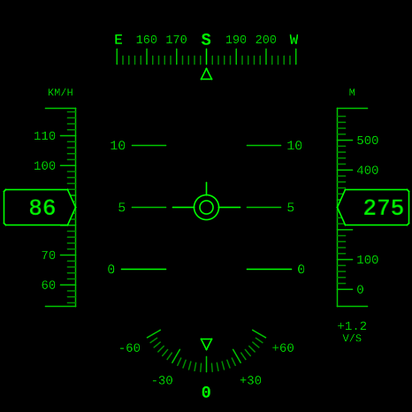
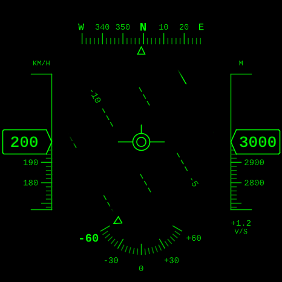

# HUD 固件接入验证

2026-09-10。将已确认的 `preview/hud.html` 移植为独立 C++ HUD 绘图核心，并加入现有仪表切换。**放大版已自动烧录并通过写入哈希校验；完成 96 秒串口测量。HUD 约 16–17 FPS，尚未达到 30 FPS。实际屏幕撕裂情况未通过串口作判断。**

## 使用方式与数据

开机仍为空速。短按 BOOT 循环：空速 → 姿态 → 高度 → HUD → 空速。串口 `u` 进入 HUD，长按 BOOT 1.5 秒或 `d` 切换它独立的全模拟演示。`c` 退出姿态演示并重新校准。原有 `a/h/t`、`v135\n`、`b275\n` 保持原义；可以先设空速或高度，再发送 `u` 返回 HUD。

HUD 默认用板载 IMU 的俯仰与横滚。空速、高度、由高度变化导出的升降率及航向均为模拟；板载六轴 IMU 没有提供真实航向。本次未添加空速、高度或航向传感器协议。HUD 保留用户确认的无底部文字版式，FPS 在串口日志中读取。

## 实现

- 466×466、荧光绿、顶端动态方位字母；四侧长短线和密度统一。
- 常规/粗体字形混合、连续字号与亮度，保留机械轮式数字，按字形高度居中。
- 主读数 26px（原 20px），侧轴数字 14px（原 11px），选中刻度最大 19px；上下刻度总宽 208px。长短刻度 17/9px、线宽 1.5px。上下指针共用 12×12px 空心三角；中心半径 14/7.5px 双圆环；侧边额外三角和横线已移除。
- 俯仰线支持负俯仰虚线、旋转与边缘淡出。横滚指示尺限 ±60°，俯仰梯仍跟随完整的真实横滚。
- 48,000 字节的常规/粗体灰度字形子集存入 Flash，固定容量命令列表存入 PSRAM。逐帧不进行动态内存分配。
- 复用三个在途帧槽，准备后只读；两核绘制交错区域，等待双方完成再同步传输。首次/切换/丢弃后的帧全屏恢复，其余七个扫描顺序区域共 163,036 像素，约为完整帧的 75%。中间区域分成四个 64 行条带交错绘制，以均衡两核负担。
- HUD 旧姿态在队列中变陈旧时丢弃，并使下一帧强制全屏恢复，防止旧仪表残留。IMU 无效的 HUD 会省略姿态梯和活动横滚指针，保留中心标记及模拟刻度，显示 `IMU`。

## 验证

- `sh tools/hud_test.sh`：ASan/UBSan，输出缓冲前后保护、native/wire 对应、中心双环、七区域逐像素重建、跨北/刻度极值/机械变化、独立帧槽并行、无效及最大有限浮点输入。新增真实横滚 60°/90° 区别测试在修复前失败；极大有限横滚溢出在修复前报告 UBSan 错误，归一化后通过。脚本会构建 `build/render_hud`。
- `SANITIZER=thread sh tools/hud_test.sh`：独立已准备槽并行绘制通过。
- `sh tools/airspeed_test.sh`、`sh tools/altimeter_test.sh`：现有仪表及四模式控制、独立演示、输入校验、升降率计算与时钟回绕通过。
- `sh tools/test.sh`：姿态滤波、绘图、阴影、诊断、安装轴向、FPS、传输、栅格边界与圆形分带回归通过。
- 独立审查随机采样 2,000 帧，覆盖俯仰 ±90°、横滚 ±180°、航向、两侧数值与无效状态，七区域外像素保持一致。
- `sh tools/build.sh`：程序 632,158 字节，静态 RAM 35,100 字节；最终增量构建无警告。完整构建曾报告厂商未使用的 LCD8 驱动既有整数收窄警告，HUD 自身的链接域警告已修正。
- `git diff --check` 通过。检查了同一份 C++ 核心导出的默认画面与航向 359°、横滚 −60°、俯仰 −8° 画面。

## 放大版固件记录

产物：`build/firmware/AttitudeIndicator.ino.bin`。
放大版首次测量 SHA-256：`d70fc7fa1039eaece5a10e75723dde369a1e0e7794aaf01580d360fa69bc3ed7`。

用户明确授权“允许自动烧录”后，使用 `sh tools/flash.sh /dev/cu.usbmodem21101` 写入放大版，工具退出 0，报告 `Hash of data verified`。此前自动审批阻止烧录的问题已解决。

## 板载测量与性能限制

使用 `build/hud_measure.py` 采集 96 秒、98 条串口记录；每阶段排除前两条 FPS 样本以避开切换窗口。原始记录：[放大版](hud-board-measurements.json)、[初版基线](hud-initial-board-measurements.json)。测试结束返回默认真实 IMU 姿态 HUD，其他 HUD 数据仍为模拟。

| 阶段 | 样本数 | FPS 最低 / 中位 / 最高 |
| --- | ---: | --- |
| HUD 真实姿态 | 11 | 15.9 / 16.6 / 17.3 |
| HUD 全模拟 | 40 | 15.6 / 16.3 / 16.9 |
| 姿态仪 | 5 | 38.5 / 39.3 / 40.0 |
| 高度计 | 5 | 50.7 / 57.7 / 60.7 |
| 空速表 | 5 | 55.7 / 59.6 / 60.6 |
| 切回 HUD 真实姿态 | 17 | 15.9 / 16.4 / 17.1 |

IMU 采样约 200 Hz；测量窗口内累计 drops 保持 166，没有新增，TE miss 为 0。空闲堆由 14,020 字节降至 13,932 字节后保持到结束；这次短测不能证明长期没有泄漏。未见 panic/看门狗错误。仪表切换后的日志模式与命令一致，物理画面撕裂仍需目视验证。

通过 Xtensa 反汇编确认文字像素循环包含软件浮点除法，把缩放倒数和线段常量提前计算。48 帧优化前后比较共 10,423,488 像素，仅两像素绿色通道相差 1/63。该等价性比较在放大布局之前完成。

放大后传输面积及字形覆盖增加，最终并未获得明显 FPS 提升，仍与初版约 15–17 FPS 接近。HUD 全模拟时两核绘图累计耗时中位数 105.8ms，传输中位数 24.9ms；绘图耗时是两核合计，不能直接取倒数当 FPS。当前仍受软件栅格绘图负担限制，不能宣称已经达到性能目标或硬件极限。

字形来源：[Liberation Fonts 2.1.5](https://github.com/liberationfonts/liberation-fonts/releases/tag/2.1.5)，SIL OFL 1.1；完整许可证和归属见 `firmware/AttitudeIndicator/HUD_FONT_LICENSE.txt`。再生成脚本是 `tools/generate_hud_font.swift`。

## 两侧机械读数滚动修复

用户反馈跳字卡顿后，定位到原动画每轮先等待 70ms，再用 130ms 三次缓动快速翻动。在约 16 FPS 时会连续两帧不动，随后只有约两帧完成翻动。新增左右数字窗口的 63ms 帧间隔回归，旧实现第一帧像素不变，断言失败。

修改为无等待的 240ms smoothstep 滚动，第一次更新即消费帧间隔，连续变化保留跨轮剩余时间；不在翻动中途重置。新增回归验证四个连续更新帧都改变、到达目标后稳定；ASan/UBSan 通过。HTML 同步修改，浏览器没有警告或错误。修改只处理数字动画节奏，不能消除低帧率本身的限制。

更新后程序 627,934 字节，静态 RAM 35,100 字节；自动烧录工具退出 0，写入哈希校验通过。

当前滚动修复固件 SHA-256：`c9bb31833ec8d1b2de39830bdeac26f779b6e44a8ba810cae043c10ec50a18c0`。复测 35 秒，排除演示阶段前两条窗口后 22 条样本，FPS 最低/中位/最高 15.6/16.4/16.9；堆保持 14,172 字节，drops 保持 16，TE miss 为 0。原始记录：[滚动修复复测](hud-smooth-board-measurements.json)。结束时已返回真实 IMU 姿态 HUD。
