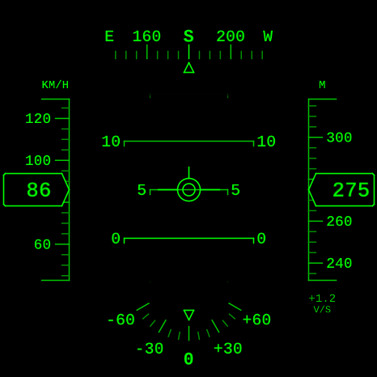
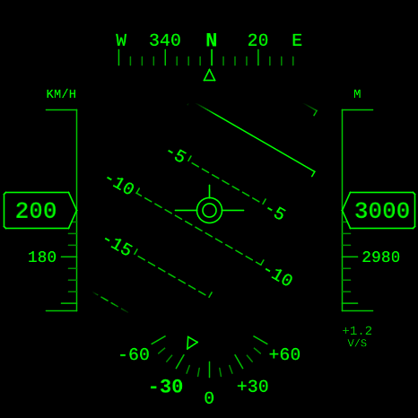
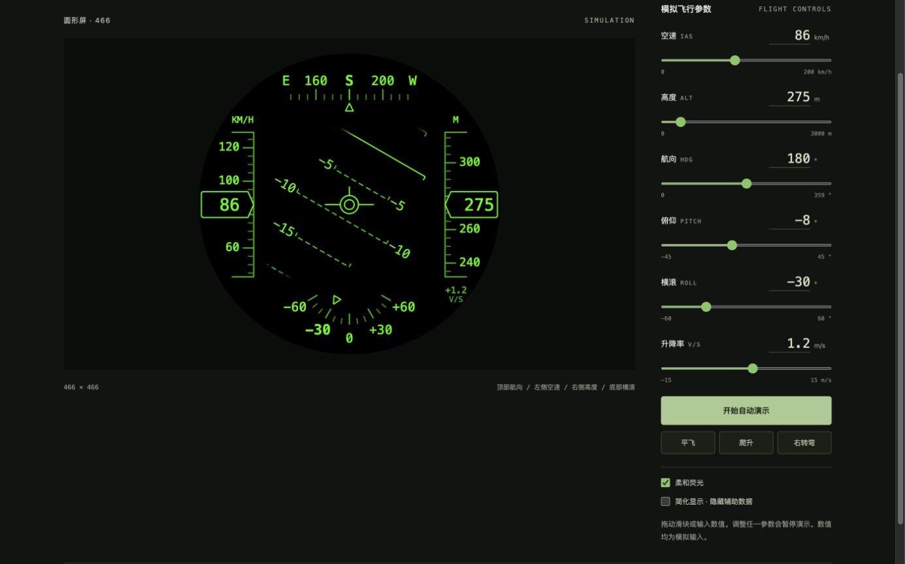

# HUD 俯仰虚线、端钩与实际字形边界验证

2026-09-10。HTML 和固件更新完成，自动烧录工具退出 0，写入哈希校验通过。

## 最终显示

- 高度刻度每大格 20 米、小格 5 米，0–3000 米量程不变。
- 俯仰每 5° 一行，间距 60px；每条刻度都有 20px 数值。10° 长线总宽 160px、5° 短线总宽 96px。
- 正俯仰实线，负俯仰虚线（8px 线段、5px 空隙），中央不留原有大缺口。两端各有 6px、朝地平线方向的竖线。
- 标签距离线端 4px；左右显示范围扩大到 x=102–364。使用实际字形边界取代过大的文字矩形，完整字形才整组显示，保留全亮与抗锯齿。负值通过减号与虚线共同区分。

## 边界和性能处理

字号 20px 时原先使用的保守 28px 高矩形，加上左右留白，导致实际有空间的字形被提前隐藏。生成字体时额外计算两种字重的字形边界，共 100 字节元数据；运行时旋转实际边界并包含双线性采样余量。避免开机/首次 HUD 扫描整套位图。

长斜线采用逐行窄区间，减少空白像素计算。修改后的覆盖率公式不变；在后续样式调整前的 500 帧、108,578,000 像素中，全帧哈希完全一致，包含接近水平的斜线。

## 检查

- `sh tools/hud_test.sh` ASan/UBSan 通过：长短几何、所有行标数、正负端钩、负值虚线及中央相位、实际字形边界、既有机械滚动/三槽/区域重建等。
- 2,000 随机姿态帧检查通过，全部绘图位于七个刷新区域和圆形屏内；面积 163,972 像素。
- 字体重新生成后，所有既有像素字节保持不变，只增加字形边界数据。
- 检查默认画面和俯仰−8°/横滚−30°：以前未显示的左侧−10和−15现在可见。HTML 重载后无浏览器警告/错误。
- 编译程序 628,550 字节，静态 RAM 35,100 字节。`git diff --check` 通过。

## 板载复测

固件 SHA-256：`a7152fcecd1f6379c7d6faae449f71e1c2290692fd20a022d448a755615960dc`。原始记录：[35秒串口数据](hud-hooked-board-measurements.json)。

全模拟演示阶段排除前两条过渡窗口后 22 个样本，FPS 最低/中位/最高 13.1/13.7/14.4；传感器采样约 200 Hz，TE miss 为 0，累计 drops 保持 9。字形边界运行时扫描版本曾记录 1055.1ms 的累计最大帧间隔，最终预计算版本为 113.0ms；这是两次短测的观测，不能将整个差异唯一归因于改动。

此次前段 IMU 尚未完成静止校准（cal=0），演示不受影响。后段完成 cal=400；测量结束回到真实 IMU 姿态 HUD，末条 valid=1。空闲堆随校准状态由 14,260 降至 14,120 字节，未进行长期内存验证。

当前并未达到 30 FPS；最新样式与旧版不同，不能把跨样式帧率差异当作单项性能优化的收益。日志不用于判断物理屏幕撕裂。
