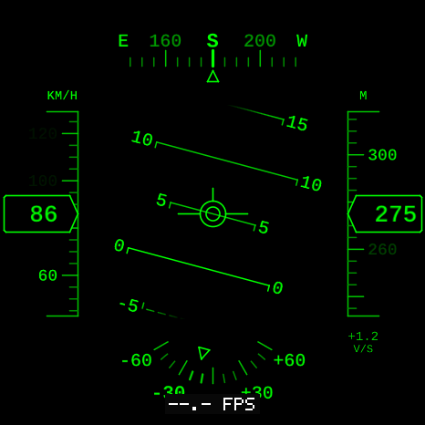
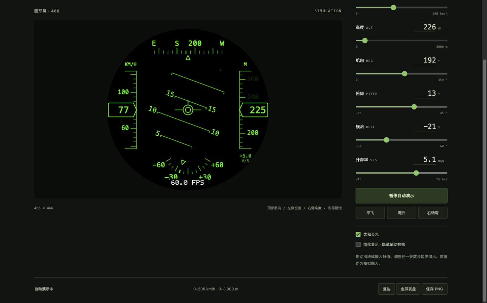

# HUD FPS 优化与可读性调整（第一阶段历史记录）

> 本文记录第一阶段 25.1 FPS 版本。后续按位连续滚动与 40 FPS 优化见 [最新验证](hud-40-validation.md)。

2026-09-10。本轮目标是降低 CPU 绘制成本，不改变屏幕频率、SPI 频率、分辨率或 IMU 采样策略。期间用户追加整组读数随动、降低滚动速度，以及刻度文字边缘渐隐要求。

## 优化依据和实现

- 同样的 25 秒 HUD 演示窗口中，优化前中位数 13.5 FPS，合计双核绘图约 120ms，传屏约 25ms。主机 300 帧分项测量中，文字占主要绘图成本。
- 字形只扫描覆盖两种字重及双线性采样边缘的实际墨迹范围，不扫描透明留白。
- 两种字重共享采样坐标、边界检查和小数权重，保持原有浮点插值顺序。
- HUD 翻译单元使用 O3，以代码体积换执行速度；没有启用 fast-math，有限值和异常输入检查仍有效。
- 提前跳过不与当前刷新区域相交的字形/图形。圆环和线段用平方距离先排除完全不点亮的像素，避免无效开方；保留边界余量和原有抗锯齿公式。
- 底部文字区域交由 CPU1，减轻同时提交 DMA 的 CPU0。两个绘图核心使用同一个区域归属函数，分别写互不重叠的区域，完成后才交给传屏任务。
- 曾试验每帧缓存整体命令边界，实际 FPS 未见明确收益，因此已移除，避免额外的 PSRAM 元数据和维护成本。

## 最终读数行为

- 保留精确读数，所有数字一起滚动；数值增加时整组向下、新数值从上方进入，减小时反向。无需像刻度标签那样量化到 20 单位。
- 约 0.4s 停留、0.3s 平滑滚动，合并为最新目标，不排队回放中间数值；当前帧可能显示前一个目标或过渡中的读数，属于有意的可读性延迟。
- 按用户最终选择不要求与刻度轴严格同速，取消短行程随动与交接重影。中央窗口仍为 26px 字号，停留时按字形垂直居中。
- 两侧刻度文字接近读数框、上下端及圆形边缘前逐渐淡出；航向数字靠近端点时逐渐淡出。中央清晰度、固定 N/E/S/W 端点和俯仰字形逻辑保持。
- FPS 覆盖层复用其他表盘的白字深灰底样式，横滚不为覆盖层让位。

## 验证边界

- 在追加 UI 改动前，500 个确定性场景、108,578,000 像素与优化前完全一致，包括接近 0 的横滚角、极限姿态及读数变化。
- 最终版本的像素对照排除用户明确修改的两个读数窗口和刻度文字区域；其余像素仍与优化前一致。测试参考被冻结在 tests/fixtures/hud_raster_reference。
- HUD、读数停留/整组滚动、触摸解析/手势、四仪表控制、显示策略和 FPS 覆盖层使用主机测试验证；双核区域重建与不可变槽位也有覆盖。
- 2,000 随机帧检查圆形边界及七个刷新区域，仍为 163,972 像素。当前帧区完整包含 FPS 覆盖层。
- HTML 动画已经同步，可用于交互检查；浏览器 FPS 与开发板 FPS 不可混用。短时串口数据不能证明物理屏幕无撕裂或长期稳定性。

## 分阶段实测

统计 HUD 演示阶段第 4 秒至第 27 秒、每秒一次的实际完成传屏计数；输入为相同公式的演示，IMU 状态不影响演示姿态。原始 JSON 保留各版本 SHA-256。

| 版本 | 样本 | 最低 FPS | 中位 FPS | 最高 FPS |
|---|---:|---:|---:|---:|
| [优化前](hud-perf-baseline-board-measurements.json) | 22 | 12.9 | 13.5 | 14.2 |
| [字形范围与共享采样](hud-perf-text-board-measurements.json) | 23 | 18.9 | 19.6 | 20.2 |
| [区域预判与 O3](hud-perf-cull-o3-board-measurements.json) | 23 | 21.9 | 22.9 | 23.5 |
| [双核区域分配](hud-perf-balance-board-measurements.json) | 23 | 23.2 | 23.8 | 24.5 |
| [省略无效距离开方](hud-perf-shapes-board-measurements.json) | 22 | 24.1 | 24.5 | 25.5 |
| [命令边界缓存试验（已移除）](hud-perf-bounds-board-measurements.json) | 22 | 24.1 | 24.5 | 25.1 |
| [最终版：精确整组滚动与渐隐](hud-performance-board-measurements.json) | 23 | 24.8 | 25.1 | 25.9 |

最终演示中位数从 13.5 提高到 25.1 FPS（约 86%）。仍未达到 30 FPS，不能视作硬件极限。中间优化阶段 UI 保持，最终读数/淡出样式为用户追加改动，因此最终跨版差异不全是同画面的单项性能收益。

程序 642,034 字节，静态 RAM 35,156 字节；固件 SHA-256：`14eece253a9421a485e2bf60a15ae106391233e89d361558d3be57d3674de8c3`。自动烧录退出 0、写入哈希校验通过。最终演示期间 IMU 尚在静止校准，演示姿态独立于该状态；演示有效帧率与无效 IMU 简化画面的帧率分开统计。

