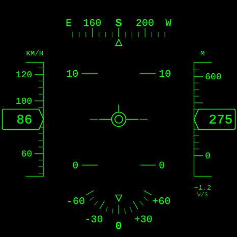
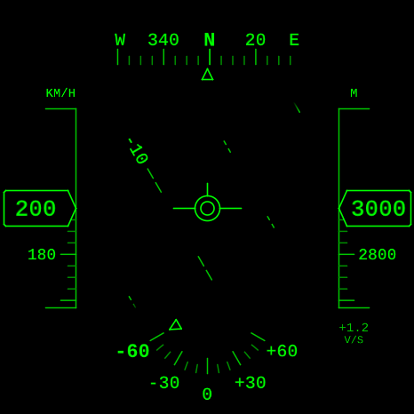
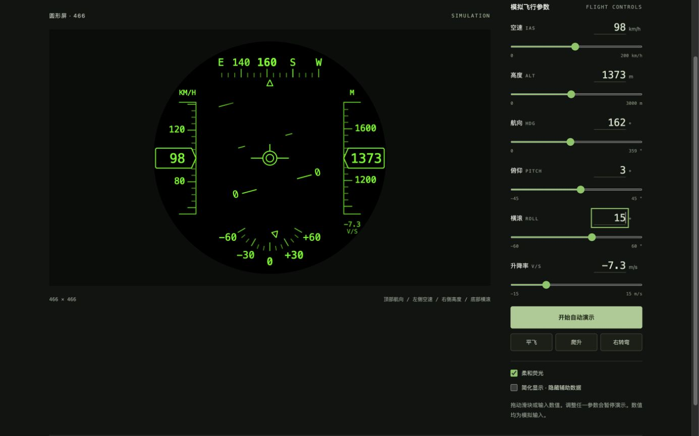

# HUD 稀疏大字刻度验证

2026-09-10。按用户要求稀疏所有刻度、放大数字，移除俯仰数字边缘淡出，并恢复俯仰长短交错。HTML 和 ESP32 固件均已更新，自动烧录完成，写入哈希校验通过。

## 最终布局

- 周边小刻度：航向 5°、空速 5km/h、高度 50m、横滚 10°；物理间距约 13px，长短线长度仍为 17/9px。
- 两侧刻度数字 18px，航向和横滚数字 20–22px，俯仰数字 20px。左右框内读数仍为 26px，240ms 无等待滚动保留。
- 俯仰每 10° 长线、5° 短线交错，相邻行距离 90px；长短线半宽分别 72/56px，中央空隙半宽 42px。0° 与其他长线同宽，只有长线标数字。
- 负俯仰用两段虚线，整体跨度与正俯仰对应线一致。
- 数字完整位于视区时保持亮度，超出时整组隐藏；不再叠加俯仰字形的两层边缘淡出。横滚数字保持全亮、增加常规笔画重量，选中强调仍平滑变化。
- 增大末尾刷新条带，七区域合计 163,972 像素。

## 验证证据

`sh tools/hud_test.sh` 通过 ASan/UBSan：包括 0°/10° 同宽、5° 更短、边缘完整数字保持亮度和越界整组消失，以及既有滚动/缓冲/区域重建测试。随机 2,000 帧覆盖航向、俯仰、横滚、读数和无效姿态，全部可见像素位于刷新区域和圆屏内。`git diff --check` 通过。

检查 C++ 默认图和航向359°/横滚−60°/俯仰−8°/空速200/高度3000图；HTML 重载后也检查了默认和倾斜布局，浏览器无警告/错误。截图见下方。

`sh tools/build.sh`：程序 628,014 字节，静态 RAM 35,100 字节。`sh tools/flash.sh /dev/cu.usbmodem21101` 退出 0，报告 `Hash of data verified`。

固件 SHA-256：`9639b8c34178d7513e6b5cab9e198dc4bb1c8ba4fd8d545507f5379adbd26441`。

35 秒串口复测，演示阶段去掉前两条过渡窗口后 22 个样本：FPS 最低/中位/最高 **14.7/15.8/16.6**。空闲堆保持 14,072 字节，累计 drops 保持 26，TE miss 为 0，采样约 200 Hz。原始记录：[板载测量](hud-sparse-board-measurements.json)。本次主要改善可读性，未获得明显 FPS 提升；不能从日志判断实际屏幕撕裂或长期稳定性。测量结束已恢复真实 IMU 姿态 HUD，航向和空速/高度等仍为模拟。

