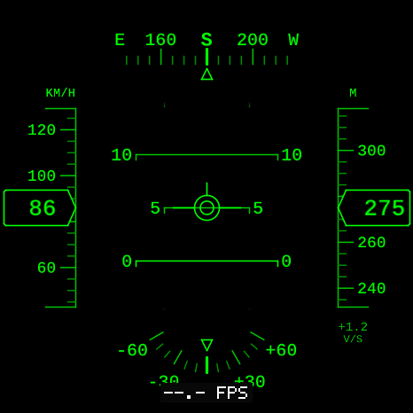
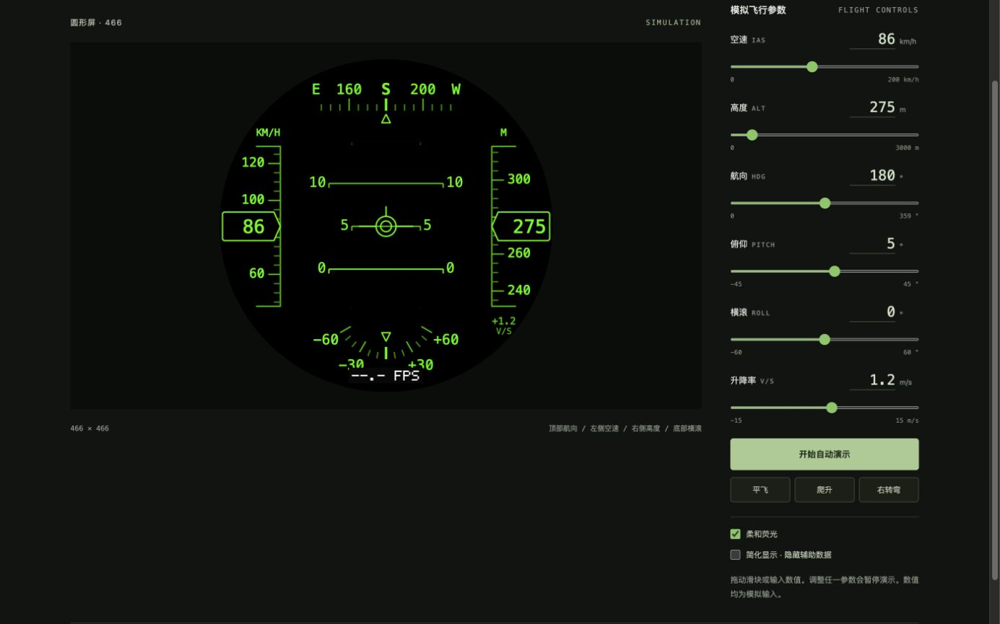

# HUD 刻度加粗、FPS 覆盖层与上下循环切换

2026-09-10。按用户既有自动烧录授权完成编译、烧录和写入哈希校验。

## 最终行为

- 上滑下一表盘、下滑上一表盘，空速 → 姿态 → 高度 → HUD 首尾循环；用户已在 USB 左侧安装方向下确认方向与循环均正确。
- 一个触摸接触最多切换一次；过滤轻触、横向移动、多点接触、超时和中断的数据。短按 BOOT 和串口控制保持可用。
- 航向和横滚指针附近的刻度线以平滑权重从 1.5px 加粗至 3.2px。
- 横滚轴保持 y=420，不为 FPS 留位置。FPS 复用既有 `FpsOverlay`，白色 5×7 字形放大 2 倍、深灰底、x=181/y=432、104×22px，与其余表盘相同。覆盖层遮住其下方图形。
- FPS 在渲染完成后、传屏之前由 display consumer 合成到归其所有的缓冲区，使用实际完成传屏的计数。HUD 不再持有单独 FPS 文本或字体。刷新区域已覆盖整个徽标，不额外传送独立 HUD 小块。
- HTML 同步相同像素字形和布局；浏览器 FPS 是预览帧率，不代表硬件。

## 验证

- 手势/协议与四模式环绕主机测试通过（ASan/UBSan）。
- HUD 主机测试通过，包括多槽不可变绘制、局部重建、极限姿态、字体/俯仰和边界。
- FPS 覆盖层测试通过，包括实际帧计数、计时器回绕、完整/局部覆盖、线序及内存边界。
- 空速、仪表控制和显示策略测试通过。
- 2,000 个随机姿态帧均位于圆屏及七个刷新区域内，区域总计 163,972 像素。FPS 完全位于最后一个区域内。
- 浏览器重载无警告/错误；已核对 HTML 和 C++ 输出。`git diff --check` 通过。
- 程序 630,334 字节，静态 RAM 35,156 字节；HUD 字体维持 48,000 字节。
- 固件 SHA-256：`1b0a9943aac169b2697c150b3eb4d74416e8e9c90d1f41b80114769c1a2a0b38`。

## 实板记录

[手势操作串口记录](hud-swipe-gesture-board-measurements.json) 捕获 33 条切换事件，包括完整循环和双向切换；该记录对应前一版绿色 FPS 固件。随后用户确认实际方向与循环均正确，最终更新只统一覆盖层显示，触摸逻辑未改。

[最终固件运行记录](hud-swipe-board-measurements.json) 记录统一样式后的短时运行。短测不构成长时间稳定性或物理屏幕撕裂验证。

最终短测中，排除开始两秒后的 23 条 HUD 记录，FPS 最低/中位/最高为 13.3/13.7/14.2；末条 IMU valid=1、采样 200.2 Hz、touch_err=0、TE miss=0。结束时运行真实 IMU HUD；没有达到 30 FPS。
